# obs-gitops-pipelines

Observability platformunun immutable artifact üretimini, dev → staging → prod promotion akışını ve Argo CD tabanlı cluster reconciliation'ını tanımlar. Component CI hiçbir zaman cluster'a doğrudan deploy etmez; image/chart yayınlar ve bu repodaki desired state için PR açar.

## Mimari karar: Argo CD

Argo CD seçildi çünkü App-of-Apps, AppProject güvenlik sınırları, multi-source Application, manuel sync, drift görünürlüğü ve Argo Rollouts ile ortak operasyon yüzeyi bu platform için güçlü bir bütün oluşturuyor. Flux daha küçük controller'lara ayrılmış, Kubernetes-native ve iyi bir alternatiftir; ancak organizasyon çapında promotion görünürlüğü, manuel prod operasyonu ve Rollouts analizi için Argo ekosistemi daha az entegrasyon işi gerektirir.

`obs-onboarding-controller` bu dokümanlarda “operator” bileşenidir. `obs-platform-infra` cluster, ağ, object store ve ilk Argo CD kurulumunu Terraform ile yapar; Argo CD kendi kurulumunu veya Terraform state'ini yönetmez.

## App-of-Apps dosya ağacı

```text
obs-gitops-pipelines/
├── bootstrap/
│   ├── dev.yaml
│   ├── staging.yaml
│   └── prod.yaml
├── projects/
│   └── observability.yaml
├── applications/
│   ├── dev/
│   │   ├── argo-rollouts.yaml
│   │   ├── external-secrets.yaml
│   │   ├── platform-config.yaml
│   │   ├── onboarding-controller.yaml
│   │   ├── notification-router.yaml
│   │   └── developer-portal.yaml
│   ├── staging/                 # aynı tam Application seti
│   └── prod/                    # automated sync içermez
├── values/
│   ├── dev/
│   ├── staging/
│   └── prod/
├── charts/platform-config/
│   └── templates/
│       ├── analysis-template.yaml
│       ├── external-secrets.yaml
│       └── vault-store.yaml
├── .github/workflows/
│   ├── reusable-component-ci.yml
│   ├── reusable-terraform-ci.yml
│   ├── obs-manifest-lint.yml
│   ├── promote.yml
│   ├── sync-production.yml
│   └── validate.yml
├── scripts/
│   ├── configure-service-repository.sh
│   └── validate.sh
└── docs/
    ├── component-ci-usage.md
    └── disaster-recovery.md
```

Her `bootstrap/<env>.yaml` yalnız o ortamın child Application CR'lerini yönetir. Child'lar OCI Helm chart'ını `ghcr.io/acme/charts` üzerinden, environment values dosyasını ise bu repodan Argo CD multi-source desteğiyle alır. Chart ve image aynı immutable SemVer değerine pinlenir.

## Promotion akışı

```mermaid
flowchart LR
    PR[Component PR] --> LT[Lint + unit test + image build + Helm lint]
    LT --> M[main merge]
    M --> P[Image + OCI chart publish]
    P --> DPR[Dev GitOps PR + auto-merge]
    DPR --> DA[Dev Argo auto-sync]
    DA --> SPR[Dev → staging promotion PR]
    SPR --> SA[Staging auto-sync]
    SA --> PPR[Staging → prod promotion PR]
    PPR --> GA[CODEOWNER + production environment approval]
    GA --> MS[Manual prod Argo sync]
    MS --> AR[Rollouts analysis]
    AR -->|healthy| OK[Promote]
    AR -->|golden signal failure| RB[Abort + stable ReplicaSet]
```



- Dev ve staging child Application'larında `automated.enabled`, `prune` ve `selfHeal` açıktır.
- Prod parent app Application tanımlarını reconcile eder, fakat prod child'larında `automated` alanı yoktur. Dolayısıyla image değişikliği yalnız OutOfSync üretir.
- `.github/workflows/sync-production.yml`, GitHub `production` environment required reviewer kapısından sonra Argo CD sync yapar ve uygulamanın Healthy olmasını bekler.
- Promotion her zaman aynı image/chart sürümünü taşır. Staging/prod için yeniden build yapılmaz.

Component repo entegrasyon örnekleri [component-ci-usage.md](docs/component-ci-usage.md) içindedir.

`obs-platform-infra` bilinçli istisnadır: deploy edilebilir proses içermediği için sahte image/chart üretmez. Ayrı reusable Terraform workflow'u fmt → validate/TFLint/test → plan → environment-onaylı apply uygular; Argo CD kurulunca workload lifecycle bu repoya geçer.

## Progressive delivery ve otomatik rollback

Onboarding controller için canary seçildi: reconciliation/webhook trafiği kademeli artırılarak controller kaynaklı geniş blast radius erken durdurulabilir. Ağırlıklar dev'de 10→50→100, prod'da 5→25→50→100 ilerler.

Developer portal için blue-green seçildi: frontend asset'leri, backend contract'ı ve kullanıcı session davranışı preview Service üzerinde birlikte test edilir; Service selector atomik değiştirilir. Prod'daki insan kapısı Argo sync başlamadan önce GitHub `production` environment'ındadır; sync onaylandıktan sonra preview analizi geçerse Service selector otomatik ve atomik değiştirilir.

`golden-signals-canary` ve `golden-signals-bluegreen` ClusterAnalysisTemplate'leri şu recording rule sözleşmesini sorgular:

| Signal | Recording rule | Gate |
|---|---|---|
| Availability | `service:sli_availability:ratio_rate5m` | Manifest SLO target'ından yüksek |
| Errors | `service:slo_error_budget_burn_rate:5m` | Canary `< 14.4`, blue-green `< 6` |
| Latency | `service:sli_latency_p95_seconds:5m` | Manifest latency target'ından düşük |
| Traffic | `service:golden_traffic:rps_rate5m` | 30 dakikalık baseline'ın %50–200 aralığı |
| Saturation | `service:golden_saturation:ratio_rate5m` | `< 0.85` |

İki başarısız canary ölçümü AnalysisRun'ı Failed yapar; Rollouts canary trafiğini sıfırlayıp stable ReplicaSet'e döner. Blue-green pre-promotion analizinde tek başarısız seri preview ReplicaSet'i abort eder. `rollbackWindow.revisions: 3` son sağlıklı ReplicaSet'e hızlı dönüş sağlar.

## Secret yönetimi

External Secrets Operator + Vault seçildi. Sealed Secrets Git'te şifreli payload taşır ve cluster private key'inin DR/lifecycle yükünü getirir; ESO modelinde Git yalnız referansı tutar, gerçek secret Vault'ta kalır ve rotasyon saatlik reconcile edilir.

Her cluster'da `observability-vault-<env>` ClusterSecretStore, ESO ServiceAccount'ın kısa ömürlü Kubernetes token'ıyla Vault'a bağlanır. Vault 1.21+ audience gereksinimi için `audiences: [vault]` açıkça tanımlıdır. Uygulamalar yalnız `existingSecret` isimlerini bilir:

```text
observability/data/dev/obs-onboarding-controller
observability/data/dev/obs-notification-router
observability/data/dev/obs-developer-portal
```

Staging/prod path'i environment ile değişir. CI pipeline'ında Vault credential yoktur; secret değişimi Vault policy/approval sürecinde yapılır.

## Bootstrap

Argo CD ve üç workload cluster kaydı `obs-platform-infra` tarafından hazırlandıktan sonra:

```bash
kubectl apply -f projects/observability.yaml
kubectl apply -f bootstrap/dev.yaml
kubectl apply -f bootstrap/staging.yaml
kubectl apply -f bootstrap/prod.yaml
```

Argo CD cluster secret'larının adları `obs-dev`, `obs-staging`, `obs-prod` olmalıdır. App-of-Apps admin yetkili bir mekanizmadır; bu repoda main branch yalnız platform CODEOWNERS tarafından onaylanmalıdır.

## Chart contract

Component chart'ları şu ortak alanları desteklemelidir:

- `image.repository`, `image.tag`, `image.pullPolicy`
- `existingSecret`, `resources`, `podDisruptionBudget`
- onboarding ve portal için `rollout.enabled`, `rollout.strategy`, strateji ayarları ve `rollbackWindow`
- Argo Rollout üretildiğinde pod template label'ları `service` ve `namespace` recording rule'larıyla eşleşmelidir
- aktif/preview Service adları values dosyasındaki rollout contract'ını izlemelidir

## Doğrulama

```bash
make validate
```

Bu komut platform chart'ını üç environment için render eder, tüm YAML'ı parse eder, prod'da auto-sync bulunmadığını ve her component için Helm chart sürümünün image tag ile aynı olduğunu kontrol eder. CI ayrıca kubeconform ve actionlint çalıştırır.

Felaket kurtarma, RPO/RTO ve restore kabul testleri [disaster-recovery.md](docs/disaster-recovery.md) içindedir.
